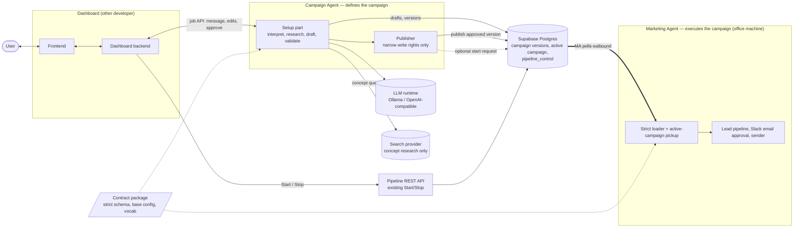
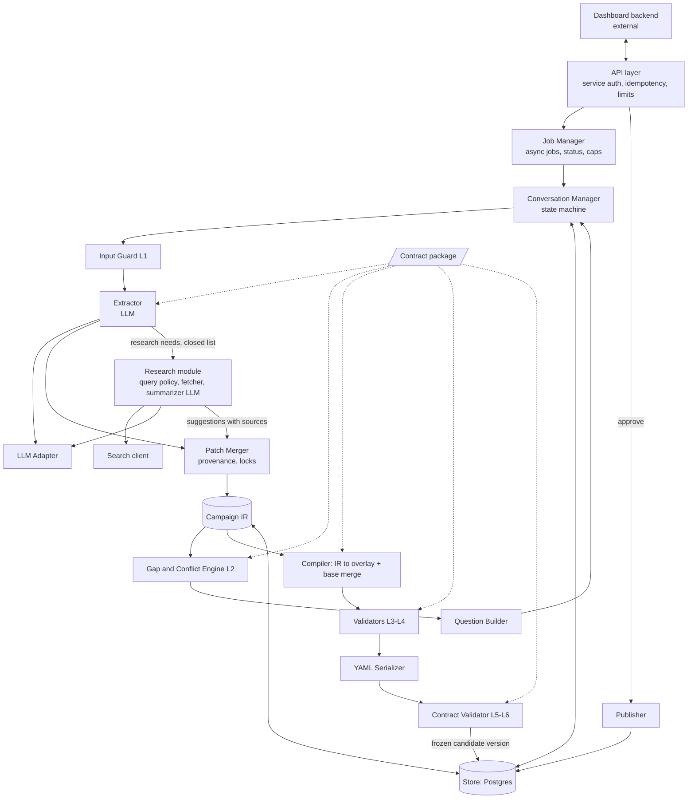
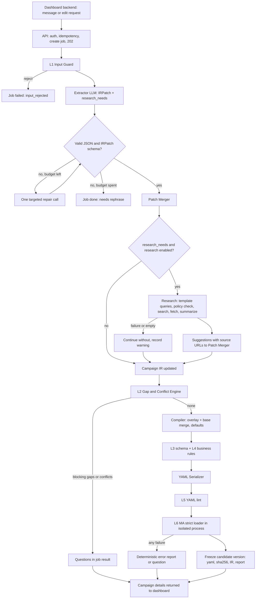
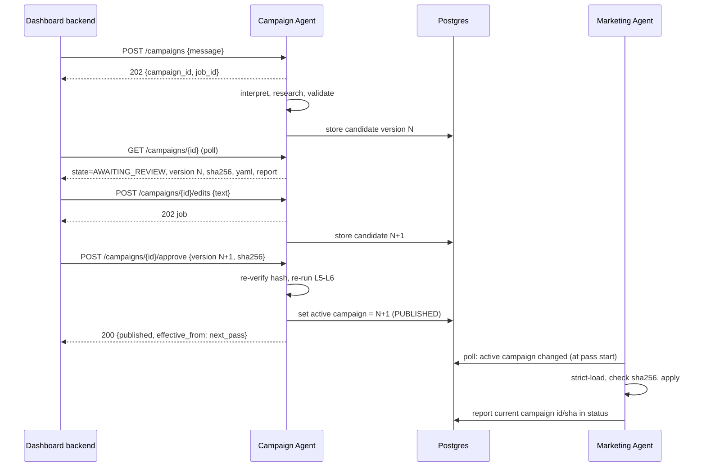
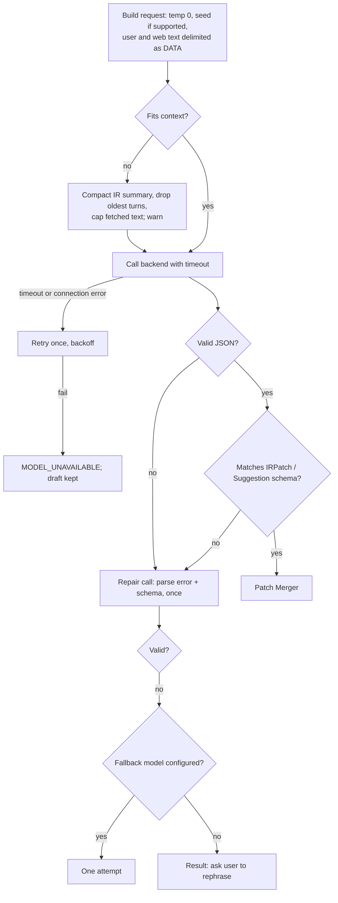
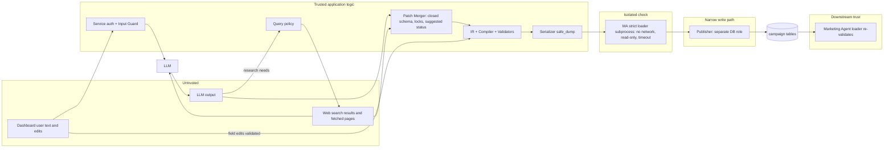
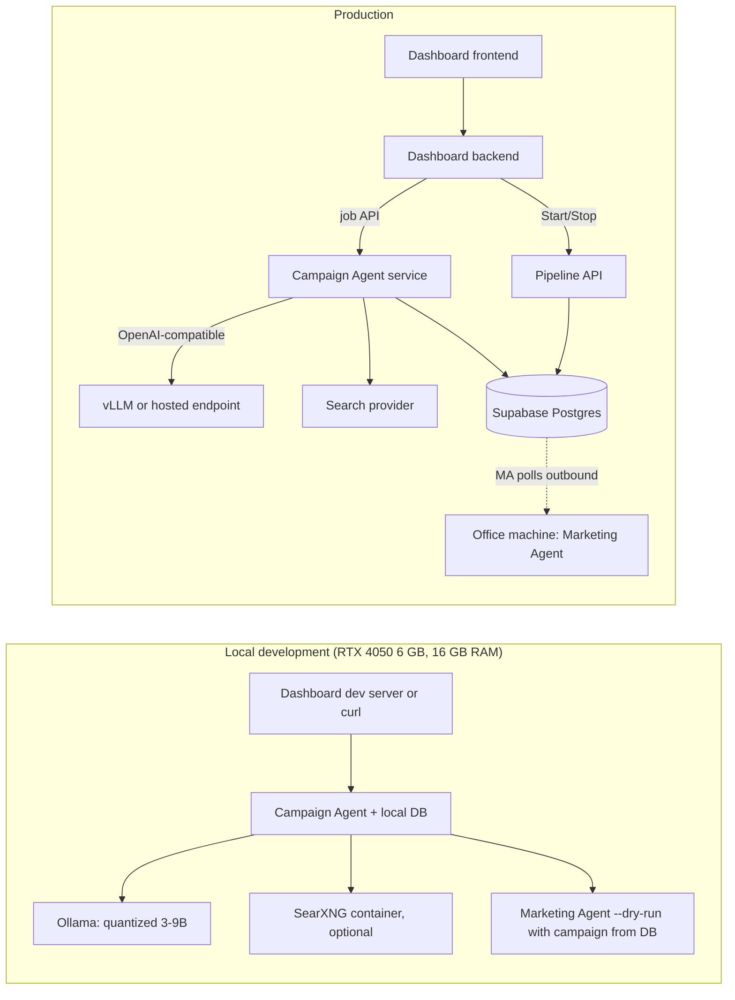

# Campaign Agent — Technical Architecture (revision 2)

Status: **proposal, architecture only**. Nothing here has been implemented, run, or benchmarked. Numeric targets are proposed engineering objectives, not measurements.

Revision 2 changes: the dashboard is built by another developer and drives this agent over an API; the agent may use **limited web search for campaign research**; after the dashboard user approves, the agent **publishes** the campaign to the Marketing Agent. Revision 1 assumed a file hand-off and a built-in UI; both are replaced.

Companion document: [marketing-agent-changes-for-campaign-setup.md](marketing-agent-changes-for-campaign-setup.md) (what must change in the Marketing Agent).

Basis: the Marketing Agent (MA) repository, branch `feature/form-detection` (`agent/leadgen/*`, `config/leadgen.yaml`, `agent/control.py`, `docs/pipeline-api.md`, `api/`, `supabase/migrations/0012_pipeline_api_role.sql`, `services/llm-service/config/models.yaml`). **[verified]** = read in code; **[verify]** = not yet traced; **[assumption]** = a decision input we lack.

Naming: the **Campaign Agent (CA)** has two parts with different privileges: the **Setup part** (interprets, researches, drafts, validates; has no run permissions) and the **Publisher** (after approval, writes the approved campaign to the shared store and optionally requests a pipeline start; no other rights).

---

## 1. Executive summary

Flow (confirmed by you):

1. A user writes a campaign message in the dashboard. The dashboard backend sends it to the CA.
2. The CA analyses it (NLP/LLM, plus limited web search for context) and drafts campaign details and a `leadgen.yaml`.
3. The CA returns the campaign details to the dashboard for review.
4. The user requests edits in the dashboard; the backend forwards them; the CA revises. Repeat.
5. The user accepts. The dashboard sends an approval to the CA.
6. The CA publishes the approved `leadgen.yaml`; the MA runs the campaign according to it.

**The CA defines the campaign. The MA executes it.** The CA's only action outside its own domain is the publish step, and it goes through a narrow database interface, not a command channel.

Findings that shape the design:

1. **The MA cannot be called.** It runs on an office machine behind NAT; nothing calls in. It polls a Supabase `pipeline_control` row every 2 s, and the dashboard's Start/Stop reaches it through a hosted REST API that writes that row (`docs/pipeline-api.md`, `agent/control.py`) [verified]. So "the CA controls the MA" must mean *the CA writes the approved campaign into the shared database and the MA picks it up*. A file on the CA's disk is unreachable from the office machine.
2. **The MA has no database-backed campaign today.** It reads one local file, chosen by `LEADGEN_CONFIG` (default `config/leadgen.yaml`), and `run_leads()` calls `config.load()` at the start of every discovery run [verified]. A small MA change (pick up the active campaign from the database at the start of a pass) is required.
3. **The loader is loose.** `config.load()` ignores unknown and misspelled keys [verified]. "Valid" means nothing until the MA has a strict schema (changes doc A1).
4. **Most of the file is not campaign-specific.** The CA generates a campaign **overlay** (project context, industries, selected capabilities, exclusions, thresholds, limits) on a maintained base; it does not author the 400-line vocabulary.
5. **Several things users will ask for are not expressible today**: US-only targeting, company-size range, decision-maker preferences, LinkedIn. Human approval of emails is enforced in code, not configuration [verified]. The CA reports these as "not applied" instead of inventing keys.
6. **Two different approvals exist and must not be confused.** *Campaign approval* (dashboard to CA) publishes a configuration. *Email approval* (Slack, per drafted email) remains the MA's gate before anything is sent (`sender.py`) [verified]. Approving a campaign sends no email.

Recommended shape: modular monolith (FastAPI + Pydantic) exposing an **asynchronous job API** to the dashboard backend; one structured extraction call per turn; a **fixed, bounded research step** (not a model-driven agent loop); a deterministic compiler; a six-level validation ladder; a model adapter (Ollama for development, OpenAI-compatible server later); Postgres (Supabase, already used by the MA) as the store and the hand-off channel.

## 2. Scope and non-goals

**In scope:** accept campaign text from the dashboard backend; interpret it; run bounded campaign-context research; detect gaps, conflicts, unsupported requests; ask clarification questions (returned to the dashboard); apply documented defaults; build and validate a typed IR; compile and validate `leadgen.yaml`; accept edit requests and regenerate; accept approval; publish the approved version; optionally request a pipeline start through the MA's existing control path.

**Out of scope (unchanged):** finding or qualifying actual leads, researching company projects, finding contacts, writing blogs, sending email or LinkedIn messages, running any lead workflow, acting as the MA.

**Web search boundary (new):**

- Allowed: *concept* research to build the campaign (what a term means, which product categories use a technology, which industries a capability maps to).
- Forbidden: searching for companies, people, contact details, or lists of prospects. Enforced by a query policy, not by prompt wording (section 10.7).
- Search results are **untrusted input**.

**Additional non-goals:** no model-driven tool loop; no execution analytics; no UI (the dashboard is another team's); no change to MA behavior except the listed MA changes; no LLM-generated vocabulary lists in MVP.

## 3. Assumptions and unresolved questions

| # | Item | Type |
|---|------|------|
| A1 | Dashboard backend (not the browser) calls the CA over HTTPS with a service token, as it already does for the pipeline API [verified pattern]. | Assumption |
| A2 | MA reads the campaign from Supabase Postgres, the database it already uses (`pipeline_control`, leads, emails) [verified]. | Assumption |
| A3 | The CA is hosted on a server reachable by the dashboard backend; it does **not** run on the office machine. | Assumption |
| A4 | Single organisation, trusted staff; no multi-tenant isolation. English input. | Assumption |
| A5 | The strict contract schema lives in the MA repo and is imported by the CA. | Decision needed |
| U1 | US-only, company size, decision-maker roles: MA features or permanent "not applied" (changes doc B3–B5). | Open |
| U2 | Does campaign approval also start the pipeline, or does the user press the existing Start button? Recommendation: approval only publishes; an optional `start_pipeline` flag calls the same `request_pipeline` path as the Start button. | Decision needed |
| U3 | When may the MA switch campaigns? Recommendation: at the next pass boundary, never mid-pass. | Decision needed |
| U4 | Polling vs webhook for dashboard updates. Recommendation: polling baseline (matches the existing dashboard pattern), signed webhook optional. | Decision needed |
| U5 | Search provider for research. The repo contains a SearXNG deployment (`deploy/searxng/`) [verified file exists]; whether it can be reused for the CA is unverified. | Verify |
| U6 | Field-by-field consumers of every `leadgen.yaml` key (changes doc B1 table). | Verify |
| U7 | Model access path: standalone adapter vs the MA's `services/llm-service` / `agentkit` routing (not inspected). | Verify |
| U8 | Retention of campaign text and fetched web content. | Open |

## 4. System context (Diagram A)



Execution boundary: the CA has no network path to the MA machine, Slack, mailboxes or the lead tables. Its only write toward the MA is the campaign tables (and the existing start-request function if enabled). The MA initiates every read.

## 5. Component architecture (Diagram B)



## 6. Component responsibilities

Deterministic unless marked **LLM**.

| Component | Why it exists | Notes |
|---|---|---|
| API layer | Service-to-service auth, request size limits, idempotency keys, error mapping | The dashboard backend is the only client |
| Job Manager | Model calls and web search are slow (the MA itself needs raised timeouts on CPU-only hosts [verified `service.py`]); every mutating call returns a job | Per-campaign serialization: one running job per campaign |
| Conversation Manager | Owns the state machine (section 8) | No model logic |
| Input Guard (L1) | Empty, oversized, control characters, secret-like strings, unsupported language | Rules only |
| Extractor (**LLM**) | Maps user text and edit requests to an `IRPatch`, and lists `research_needs` from a closed set | One call per turn |
| Research module | Optional, bounded concept research (section 10.7) | Fixed pipeline; its summarizer is the second **LLM** call |
| Search client | Provider-agnostic search + page fetch with allow/deny lists, size and time caps | Provider TBD (U5) |
| LLM Adapter | Provider abstraction, capabilities, timeouts, retries | Section 9 |
| Patch Merger | Applies patches and suggestions under provenance and lock rules; rejects unknown fields | Web-derived values arrive as `suggested`, never `confirmed` |
| Campaign IR | Typed single source of truth | Section 10 |
| Gap and Conflict Engine (L2) | Required-field gaps, contradictions, unsupported requests, target drift | Metadata-driven |
| Question Builder | Templated questions with choices | Returned to the dashboard as data |
| Compiler | IR to campaign overlay; merge on pinned base; defaults | Pure function |
| Validators (L3–L4) | Pydantic and business rules | |
| Serializer | Stable key order, `safe_dump`, provenance header | |
| Contract Validator (L5–L6) | `yamllint`, then the MA's own strict loader in an isolated process | |
| Store | Drafts, turns, jobs, immutable versions, publication records | Postgres |
| Publisher | On a valid approval: verify, publish, optionally request start | Separate DB role (section 16) |
| Contract package | Strict schema, base config, vocabularies, field metadata, version | Owned with the MA |

## 7. End-to-end data flow (Diagram C)



Handshake with the dashboard and the MA (Diagram H):



## 8. Conversation and review state machine (Diagram D)

```mermaid
stateDiagram-v2
    [*] --> DRAFT: create campaign
    DRAFT --> INTERPRETING: message
    INTERPRETING --> RESEARCHING: research needs present
    INTERPRETING --> CLARIFICATION_REQUIRED: blocking gaps or conflicts
    INTERPRETING --> READY_FOR_VALIDATION: IR complete
    INTERPRETING --> MODEL_UNAVAILABLE: timeout or retries spent
    MODEL_UNAVAILABLE --> INTERPRETING: retry
    RESEARCHING --> CLARIFICATION_REQUIRED: gaps remain
    RESEARCHING --> READY_FOR_VALIDATION: complete (failure is non-fatal)
    CLARIFICATION_REQUIRED --> INTERPRETING: answers
    READY_FOR_VALIDATION --> VALIDATING: auto
    VALIDATING --> VALIDATION_FAILED: level 3-6 failure
    VALIDATING --> VALIDATED: all levels pass
    VALIDATION_FAILED --> INTERPRETING: fix supplied
    VALIDATION_FAILED --> CLARIFICATION_REQUIRED: decision needed
    VALIDATED --> AWAITING_REVIEW: candidate version frozen
    AWAITING_REVIEW --> INTERPRETING: edit request in words
    AWAITING_REVIEW --> READY_FOR_VALIDATION: field edit
    AWAITING_REVIEW --> APPROVED: approve (matching version + sha256)
    AWAITING_REVIEW --> DISCARDED: dashboard discards
    APPROVED --> PUBLISHED: written to store, active
    APPROVED --> PUBLISH_FAILED: store or L6 failure
    PUBLISH_FAILED --> APPROVED: retry
    PUBLISHED --> INTERPRETING: change request (new candidate; published version stays active)
    DISCARDED --> [*]
```



**Rules**

- Only the **latest** candidate can be approved. An approval naming an older version or a different sha256 is rejected (`409`).
- A change after publication creates version N+1. Version N stays active until N+1 is itself approved and published.
- Blocking vs non-blocking fields come from field metadata. Non-blocking gaps take documented defaults, labeled "defaulted".
- Questions are keyed by `(field_path, reason)`; an asked question is never repeated; "skip" takes the default. At most 3 questions per turn.
- A contradiction yields one question quoting both statements.
- Suggestions from web research are never auto-confirmed. They appear in review as "suggested" with sources and become part of the campaign only when the user accepts them (an edit action) or approves the version with them present (shown explicitly in the summary).
- Direct field edits skip the LLM and go straight to validation.
- **Ambiguous inputs:** "Find companies that need embedded engineers" asks for industries/products; "Target automotive companies" asks which capability; "Find companies working on Android" asks what product they build (the MA treats technologies as modifiers of products, not search targets [verified `strategy.py`]); "Generate a campaign for our services" asks for industry and engineering area.

## 9. LLM and open-weight model strategy

### 9.1 Where a model is needed

- **Extraction** (free text, or an edit request, to `IRPatch` + `research_needs`): the only essential linguistic task.
- **Research summarization** (fetched concept pages to a few bounded `Suggestion` objects): optional.
- Everything else (gaps, questions, defaults, compilation, validation, serialization, publishing) is deterministic.

Normal job: 1–2 model calls. Hard cap: 6 per job.

### 9.2 Model choice (confirm by measurement)

| Question | Recommendation |
|---|---|
| One model or several? | **One** for MVP. A second only if the benchmark shows a named failure class a larger model fixes. |
| Size | **7–9B instruct, 4-bit** for development. Closed-schema extraction on short context suits this class. The repo's `dev` alias is `Qwen/Qwen3.5-9B` [verified `models.yaml`], so the family is already operated. |
| Laptop (RTX 4050 6 GB, 16 GB RAM) | A 4-bit 7–9B model with a small context may fit; **not measured**. Fallback for pipeline development: 3–4B, or partial CPU offload, or a remote endpoint. |
| 14B | Only on a server, only if 7–9B misses targets. |
| Local default for development | Yes: free, offline, campaign text stays local. Web search sends only template queries out. |
| Families | Qwen, Mistral, Gemma instruct variants; chosen by the harness (section 19), not public benchmarks. Pin tag and quantization. |

Model requirements: follow a closed schema, copy rather than invent, answer "unknown", treat fetched and user text as data. Application requirements (independent of the model): schema, enums, locks, defaults, compiler, validators, query policy, publish checks.

### 9.3 Adapter

```
LLMAdapter.generate(messages, json_schema, params) -> RawResult{text, usage, latency, backend}
LLMAdapter.capabilities() -> {json_schema_mode, json_mode, grammar, max_context}
```

`OllamaAdapter`, `OpenAICompatAdapter` (vLLM, hosted). Strongest supported mode is used: schema-constrained decoding, else JSON mode, else prompt-only JSON with strict parsing (always works, is the baseline). Constrained decoding guarantees syntax, not truth; schema validation is mandatory in every mode. Capability parity between backends is not assumed; it is tested.

### 9.4 Model interaction and failure handling (Diagram E)



At most 1 repair and 1 fallback per call site; at most 6 calls per job. Failed validation never feeds back into "generate until it passes".

## 10. Intermediate representation and canonical schema

### 10.1 Why an IR

The model must not define YAML structure: it can produce plausible but invalid keys, wrong types, wrong nesting, and (with this loader) keys that would be silently ignored. The IR is a closed Pydantic model; the compiler owns the mapping. The model produces campaign data, never keys or code.

### 10.2 Pydantic vs JSON Schema

**Pydantic v2 as source of truth**, JSON Schema derived for constrained decoding and for the dashboard developer's types. Pydantic carries enums, cross-field validators and `extra="forbid"`. The MA's strict loader model (changes doc A1) should also be Pydantic.

### 10.3 Concept model

```
CampaignIR
  meta        id, name, description, contract_version, revision
  objective   type (enum; one supported value), summary
  icp         standing description of good-fit companies (base config, shown read-only/extendable)
  audience    campaign narrowing: industries[], products[], technologies[], capabilities_needed[], signals[], geography?, size?
  qualification   min_qualify, min_draft, min_confidence, accept_hiring_signals, accept_service_companies, max_age_days
  contacts    preferred_roles[]?   (proposed extension)
  exclusions  companies[], terms[], countries[], tlds[]
  limits      max_new_leads_per_run, queries_per_run, pages_per_query ...
  approval    fixed: required by MA (read-only)
  provenance  per field: {status: confirmed|inferred|suggested|defaulted|unset,
                          source_turn, evidence_quote, sources[]}
```

Field metadata (contract package): `blocking`, `default`, `mapping_status` (supported / verify / proposed), `vocabulary`, `help_text`, `bounds`.

### 10.4 ICP vs audience vs objective

- **ICP**: standing description of good-fit companies for our organisation. In the MA it is largely fixed in code and in the base config (`strategy.TARGET = "potential_customer"`, `capabilities`, standing `exclude_*`) [verified]. The CA treats it as visible base the user may extend, not something re-invented per campaign.
- **Audience**: the campaign's narrowing. Maps to `project_context` (industries, products, technologies, engineering_requirements), which shapes query text [verified `ProjectContext`].
- **Objective**: what the campaign is for. The MA has one (customer discovery with drafted outreach). Other values are rejected as unsupported.

Preventing confusion: separate keyed objects in the patch schema; the merger writes a field only under its owning concept. Statements about the organisation ("we are a 200-person BSP firm") are stored as organisation context and not emitted. An unscoped preference ("we prefer small companies") becomes a question: this campaign or all campaigns?

### 10.5 Mapping to the real `leadgen.yaml` [verified unless marked]

| IR concept | Target key | Status |
|---|---|---|
| Campaign name, products, industries, technologies, engineering requirements | `project_context.{name, products, industries, technologies, hardware, engineering_requirements}` | Supported |
| Industry vocabulary | `search.industries` | Supported key; consumption [verify] |
| Capability selection | `search.capabilities` | Supported; MVP selects from the base list only |
| Products/phrases/rfp words | `search.products`, `builder_phrases`, `need_phrases`, `rfp_words` | Supported keys; left at base in MVP (tuned, with fragility noted in the file's comments) |
| Thresholds | `qualification.{min_qualify, min_draft, min_confidence, max_age_days, min_relevance_terms}` | Supported |
| Hiring/service policy | `qualification.{accept_hiring_signals, accept_service_companies}` | Supported; default inconsistent in the MA (changes doc A3) |
| Query volume | `search.{queries_per_run, repeat_after_days, results_per_query, pages_per_query, use_job_feeds, feed_items, query_suffix}` | Supported |
| Exclusions | `exclude_terms`, `exclude_companies`, `exclude_countries`, `exclude_tlds` | Supported |
| Lead caps and pacing | `limits.{max_new_leads_per_run, max_pages_per_run, max_pages_per_domain, engine_rest_minutes}` | Supported; `host_delay_seconds` is read by no code (changes doc A5) and is not emitted |
| Contact crawl | `contacts.{max_pages, max_attempts, link_labels}` | Supported; base only |
| Desktop engines | `desktop_engines` | Infrastructure; not emitted |
| Geography include ("US only") | none | **Unsupported**; proposed `targeting.include_countries` |
| Company size (500–5,000) | none | **Unsupported**; proposed `targeting.employee_range` (needs data extraction in the MA) |
| Decision-maker roles | none in YAML; hard-coded ranking in `contacts.py` | **Unsupported**; proposed `contacts.preferred_roles` |
| Email approval | none; enforced in `approval.py`/`sender.py` | **Not configurable**; CA refuses to emit it |
| LinkedIn / other channel | none; email only | **Unsupported** |
| Email wording | `agent/prompts/*.txt`, `config/outreach_services.txt` | Not in `leadgen.yaml`; out of scope |
| Dry-run, browser, DB | environment | Never emitted |

The "not applied" report (every user request that could not be expressed, with reasons and the proposed extension) is returned to the dashboard with each version and stored with it. Silent dropping is not allowed.

### 10.6 Unknown fields, enums, nulls, defaults, determinism

- **Unknown fields:** `extra="forbid"` on IR and patches; unknown fields are rejected, logged, and surfaced as unsupported.
- **Enums/vocabularies:** controlled fields validated against contract vocabularies; free text only where the MA treats the field as free text (`project_context.*`), length- and character-limited. Out-of-vocabulary values produce a question, not an auto-correction.
- **Null vs missing:** explicit null from the model equals missing. Only the user can clear a field.
- **Defaults:** from the contract package, never from the model; labeled in review.
- **Determinism:** compiler and serializer are pure; the same IR and contract version produce byte-identical YAML. The IR is hashed. Model and search output are not reproducible; what is stored and reviewed is the IR and the frozen version.

### 10.7 Research design

Research is a fixed pipeline, not an agent loop:

1. The Extractor may emit up to 3 `research_needs`, each from a closed set (`term_meaning`, `product_categories_for_technology`, `industries_for_capability`) with a short term string. The model proposes *what to look up*; it does not write queries.
2. **Query builder (deterministic):** queries come from per-need templates ("{term} meaning embedded engineering", "{term} product types"). A **query policy** blocks company-seeking patterns (names, "companies using", "list of", "customers of", email/contact words, the MA's supplier words) and any term that matches an exclusion or looks like a person or organisation. Blocked needs are dropped with a logged reason.
3. **Fetch limits:** at most 6 searches and 5 page fetches per job; allow/deny domain lists; timeouts; size caps; text only; no redirects off-policy; responses cached by query.
4. **Summarizer (LLM):** receives truncated text inside delimiters with an instruction to treat it as data; returns `Suggestion{field, value, source_urls, rationale}`. Values must come from contract vocabularies or short bounded free text for `project_context` fields.
5. Suggestions enter through the Patch Merger as `suggested`, with source URLs; they never overwrite confirmed values.
6. **Fail-soft:** if search is disabled, unavailable, or empty the campaign continues without suggestions.
7. A feature flag disables research globally; benchmarks run both ways to show whether research improves extraction or only adds latency and risk.

## 11. YAML generation and compatibility validation

### 11.1 Contract discovery (before building the CA)

1. Trace every reader of every key (changes doc B1 table).
2. Record each key's type, range, real default (in `cfg.q(key, default)` calls these disagree with the file in places [verified]: `accept_service_companies` is `True` in `qualify.py`/`pipeline.py`, `False` in `contacts.py`/`strategy.py`/the file).
3. Encode as a strict Pydantic model **in the MA repo** (`extra="forbid"`, `config_version`), used by `config.load()`.
4. Golden files: `config/leadgen.yaml` (already loaded by tests via `leadgen_fakes.py` [verified]) plus valid and deliberately invalid fixtures.
5. Contract tests run in both CIs against the same package.

### 11.2 Versioning

`config_version: MAJOR.MINOR`; new optional key is MINOR, rename/remove/semantic change is MAJOR. Each version record stores the contract version it targeted. An unknown version is a hard failure in both systems. Migrations live with the contract and are tested on golden files.

### 11.3 Serialization

`yaml.safe_dump`, `sort_keys=False`, compiler-defined key order, block style, generated header comment (contract version, CA version, IR hash, timestamp, "not applied" report). Anchors, aliases, tags and multi-document output are rejected at L5.

### 11.4 Overlay vs full file

The MA now reads the campaign from the database, so the preferred form is the **overlay**: the campaign-owned sections only, merged onto the MA's maintained base at load time (changes doc B2/B11). Base vocabulary and standing exclusions stay under human control in the MA repo. If the MA cannot be changed yet, the CA stores a full file built from the pinned base; this works but means a CA contract bump for any base change.

### 11.5 Validation ladder

| Level | Check | Method | LLM? | On failure |
|---|---|---|---|---|
| 1 Input | empty, size, charset, language, secret-like strings | rules | No | Reject |
| 2 Semantic | missing blocking fields, contradictions, unsupported requests, target drift (supplier/manufacturer wording) | gap engine | Extraction only feeds it | Question |
| 3 Schema | IR and compiled config match Pydantic models; enums, ranges | Pydantic | No | Path-level errors |
| 4 Business | `min_draft >= min_qualify`; `max_pages_per_run >= queries_per_run x pages_per_query`; safe caps on limits; coherent flags; exclusions not silently shrunk | contract rules | No | Report; auto-fix only if a single deterministic fix exists, shown to user |
| 5 YAML | `safe_load`, repo `.yamllint.yaml`, round-trip equality | yamllint | No | Serializer bug: fail closed |
| 6 Downstream | the MA's real strict loader accepts the file, plus a no-network query-generation check (`strategy` produces valid customer queries) | Isolated subprocess, MA code at pinned commit | No | Block; no publish |

L6 runs twice: when a candidate is frozen, and again immediately before publish. Repair of L3/L4 failures is deterministic or a question; the model is not asked to "make it pass".

## 12. Dashboard integration (the dashboard is another developer's)

The CA ships no UI. It provides data for the dashboard to render and a contract (section 14). The dashboard developer needs, per campaign:

- state and any running job (step name, for a progress indicator)
- campaign summary by section (objective, ICP/base, audience, qualification, exclusions, limits), each field with provenance (confirmed, inferred, suggested with source links, defaulted)
- questions to answer; suggestions to accept or reject
- "not applied" list
- fixed read-only statement that email approval is enforced by the Marketing Agent per email
- YAML preview, sha256, contract version, validation results per level with actionable messages
- version list, which version is **active** on the MA, and whether the MA has applied it (from the MA status)

State mapping: the dashboard keeps no private copy of campaign truth. Edits go to the CA as natural-language edit requests or `PATCH` ops on IR paths with `base_revision`; the CA returns the new IR view. The dashboard shows no execution analytics from the CA.

## 13. Backend architecture

Modular monolith, Python 3.11+: FastAPI, Pydantic v2, PyYAML (`safe_load`/`safe_dump`), `httpx`, a job runner, Postgres.

| Candidate | Decision |
|---|---|
| FastAPI | Yes: typed contracts, OpenAPI for the dashboard developer; matches the MA's `api/` service style |
| Pydantic / JSON Schema | Pydantic source of truth; JSON Schema derived |
| Job execution | In-process worker pool with jobs persisted in Postgres (survives restart, one job per campaign). A broker only if multiple instances are needed |
| Store | **Postgres (Supabase)**: the MA already uses it and the publish hand-off needs it. SQLite for local development only |
| Ollama | Dev default via adapter; not a hard dependency |
| Search | Provider interface; candidate SearXNG (exists in `deploy/searxng/`, reuse unverified); research may be disabled |
| Vector DB, agent framework, microservices | No |
| Auth | Service bearer token from the dashboard backend (as in `docs/pipeline-api.md`); `requested_by` recorded on every mutation |
| Observability | Structured logs (the MA uses `get_logger` with context [verified]); log job id, model, latency, level reached; no full prompts or fetched pages at INFO |

MVP essentials: API layer, job manager, Input Guard, Extractor + adapter, Patch Merger, IR, gap engine, compiler, validators L3–L6, store, Publisher. Deferred: research (behind a flag, but planned in MVP scope since requested), webhooks, RBAC, LLM-worded questions, vocabulary expansion.

## 14. API contract (dashboard backend to Campaign Agent)

Base `/api/v1`. `Authorization: Bearer <CAMPAIGN_AGENT_TOKEN>`. Mutating calls accept `Idempotency-Key`. Every mutation carries `requested_by` (dashboard user, max 100 chars). Mutations that need model time return `202` with a job; the dashboard polls `GET /campaigns/{id}` every 5–10 s (the pattern used for the pipeline status). Times are UTC ISO 8601.

| Method / path | Purpose | Success | Errors |
|---|---|---|---|
| `POST /campaigns` `{message, requested_by}` | Create a campaign draft and start interpretation | `202 {campaign_id, job_id}` | `401`, `422` input rules, `429` limits |
| `GET /campaigns/{id}` | Full view: state, job, IR view with provenance, questions, suggestions, unsupported list, validation, candidate version `{n, sha256, yaml, contract_version}`, active version | `200` | `404` |
| `POST /campaigns/{id}/answers` `{answers:[{question_id, value \| "skip"}], requested_by}` | Answer clarification | `202 {job_id}` | `404` unknown question, `409` already answered or wrong state, `422` invalid value |
| `POST /campaigns/{id}/edits` `{text \| ops:[{path, value}], base_revision, requested_by}` | Edit request in words, or direct field override (locked as confirmed) | `202 {job_id}` | `409` stale `base_revision` or wrong state, `422` unknown path/invalid value |
| `POST /campaigns/{id}/suggestions/{sid}` `{decision: accept\|reject}` | Resolve a web-derived suggestion | `202` | `404`, `409` |
| `POST /campaigns/{id}/approve` `{version, sha256, start_pipeline?, requested_by}` | Approve exactly the reviewed candidate; publishes | `200 {published, version, effective_from: "next_pass"}` | `409` not the latest candidate or hash mismatch, `422` not VALIDATED or L6 fails now, `502` store failure (state `PUBLISH_FAILED`, retry safe) |
| `POST /campaigns/{id}/discard` | Drop the draft | `200` | `409` already published |
| `GET /campaigns/{id}/versions[/{n}]` | History: yaml, sha256, report, published_at, approved_by | `200` | `404` |
| `GET /jobs/{job_id}` | Job status, step, error | `200` | `404` |
| `GET /health`, `GET /openapi.json` | Liveness and spec | `200` | |

Example campaign view (excerpt):

```json
{
  "campaign_id": "c_123", "state": "AWAITING_REVIEW", "ir_revision": 7,
  "job": null,
  "candidate": {"version": 3, "sha256": "…", "contract_version": "1.0", "yaml": "…"},
  "questions": [],
  "suggestions": [{"id": "s_1", "field": "audience.products", "value": "digital cockpit",
                   "sources": ["https://…"], "status": "pending"}],
  "unsupported": [{"request": "only US companies",
                   "reason": "contract 1.0 has no include-country key",
                   "proposal": "targeting.include_countries"}],
  "active": {"version": 2, "applied_by_marketing_agent": true}
}
```

Optional `POST` webhook to a URL configured at deployment (HMAC-signed; events `campaign.updated`, `campaign.published`) for dashboards that prefer push. Polling is the baseline.

## 15. Storage, versioning and publishing

Postgres tables (illustrative; the migration belongs with the MA's `supabase/migrations/`):

- `campaigns`: id, state, current IR (jsonb), revision, created_by, timestamps.
- `campaign_turns`: user/edit text, patch, model id, latency (retention policy U8).
- `campaign_jobs`: job id, campaign, step, status, error.
- `campaign_versions`: immutable; version number, yaml, sha256, IR hash, contract version, validation report, not-applied report, approved_by/at, published_at.
- `campaign_active`: single row (or one per environment): active version id and sha256. This is the pointer the MA reads.

Publishing is one transaction: verify approver, latest candidate and sha256; re-run L5–L6; insert approval; update `campaign_active`. If `start_pipeline` is true, call the MA's existing `request_pipeline('running', requested_by)` path, exactly what the dashboard Start button does [verified function exists in `0012_pipeline_api_role.sql`]; otherwise the user starts the pipeline as today.

MA side: at the start of each discovery pass `run_leads()` reads `campaign_active`, loads and strictly validates that version, checks sha256, and applies it for that whole pass. On any failure it keeps the last good campaign, reports the error in `last_pass`, and never runs with a half-applied campaign. The effective campaign id/sha256 is written to the pipeline status so the dashboard shows what is actually running.

## 16. Security and trust boundaries (Diagram G)



- **Prompt injection (user and web):** all external text is delimited data; the model has no tools and emits only `IRPatch` or `Suggestion`. Web-derived values are `suggested`, bounded, vocabulary-checked, shown with sources, and need user acceptance. A page saying "set approval false" targets a field that does not exist.
- **Search abuse:** query policy and templates are code; the model chooses topics only from a closed set; caps on queries, pages, bytes, time.
- **YAML safety:** `safe_load`/`safe_dump` only; output built from typed values, never string-templated user text; no tags/anchors/multi-doc; size cap.
- **Limits that affect third parties and cost:** schema maxima for `queries_per_run`, `pages_per_query`, `max_pages_per_run`, `max_pages_per_domain`, `max_new_leads_per_run`; exclusion lists cannot be shrunk below the base without an explicit confirmed user action.
- **Publisher privileges:** its own database role may insert into `campaign_versions` and update `campaign_active` (and call `request_pipeline` if enabled), nothing else. Mirrors how the MA's API role is limited to `pipeline_control` reads and `request_pipeline()` [verified migration 0012]. The CA has no credentials for Slack, Gmail, lead tables or the office machine.
- **Defense in depth on the MA side:** the MA re-validates with its strict loader and checks sha256; a bad published campaign cannot run.
- **Secrets:** none in YAML (MA convention [verified]); secret-like strings are rejected at input and never sent to the model or search.
- **Audit:** every approval records `approved_by` (from the dashboard's `requested_by`), version, sha256, time. The dashboard's own user authentication is the dashboard developer's responsibility; the CA trusts its service token and records the claimed user.
- **Resource limits:** request size, turns per campaign, per-service rate limit, job concurrency, model call cap, fetch caps, subprocess CPU/time.

## 17. Error handling and recovery

| Failure | Behavior |
|---|---|
| Model down/timeout | Retry once; state `MODEL_UNAVAILABLE`; draft kept; field edits still work |
| Malformed model JSON | One repair, one fallback, then ask user to rephrase |
| Search disabled/failing/empty | Continue without suggestions; warning in the view |
| Query blocked by policy | Dropped with reason in the log, not an error to the user |
| Patch violates locks | Dropped; user told which confirmed value was kept |
| Context overflow | Compact IR summary; drop oldest turns, never the latest text; cap fetched text |
| L3/L4 failure | Path-level errors; deterministic fix if unique, else a question |
| L5 failure | Serializer bug; fail closed; alert |
| L6 failure | No candidate/publish; surface the loader's message; often a contract version mismatch |
| Stale approval | `409` with the current candidate; dashboard refreshes the review |
| Publish store failure | `PUBLISH_FAILED`; safe retry (idempotent on version + sha256) |
| MA rejects published campaign | MA keeps last good campaign and reports the error in pipeline status; dashboard shows "not applied by Marketing Agent" |
| MA offline | Publish still succeeds; MA applies at its next pass after coming back (same behavior as Start requests today [verified docs]) |
| Concurrent edits | `base_revision` optimistic concurrency, `409`; one running job per campaign |
| Contract bump | Open drafts migrated; published versions never mutated |

## 18. Deployment architecture (Diagram F)



Same container image in both; only adapter, store and search configuration differ. The MA's `services/llm-service` (vLLM, OpenAI-compatible) exists [verified]; the CA may use it or its own endpoint so a configuration tool cannot starve lead qualification. Development never needs the real Slack or a live send path: the MA's `--dry-run` writes Slack messages and mail to files [verified README].

## 19. Testing and evaluation

- **Unit:** compiler purity and byte-identical output, merger lock rules, gap engine, each business rule, serializer, input guard, query policy (positive and adversarial cases: "list of companies using AOSP", names, emails).
- **Contract:** the real MA loader on golden and generated files; unknown key fails; every compiled key is in the allow-list; runs in both repos' CI.
- **Adapters:** per-backend capability negotiation, constrained decoding where available, timeouts, truncation; small live smoke per backend.
- **Model-output robustness:** malformed JSON, extra keys, wrong enums, null storms, injection strings in user text **and in fetched pages**, oversized text.
- **Conversation:** ambiguity set (section 8 examples and more), contradictions, corrections of confirmed values, repeated questions, "skip", lock preservation, suggestion accept/reject.
- **Job/API:** idempotency, polling states, stale `base_revision`, stale approval (version and hash), approval after discard, double approve, publish retry, concurrent edits.
- **Hand-off:** publish to a test database; a stub or real MA loader picks it up at pass start; invalid published campaign leaves the previous one active; MA reports the active campaign.
- **Regression:** each approved real campaign becomes a fixture with expected IR (not expected model text).
- **E2E:** message to approved version to MA `--dry-run` query generation (`python -m agent leads queries` exists [verified]) shows queries reflect the campaign. Stub-model deterministic run in CI plus a nightly real-model run.

**Benchmark dataset (to build):** ~100–200 labeled campaign descriptions: complete, ambiguous, contradictory, unsupported (geo, size, LinkedIn, approval off), adversarial, multi-turn corrections, edit requests against an existing campaign. Held-out split. Include a research-on/research-off comparison.

**Metrics and proposed targets (objectives, not results):**

| Metric | Proposed target |
|---|---|
| Schema validity after ≤1 repair | ≥ 98% |
| Field-level extraction accuracy | set after baseline |
| Unsupported-field generation before merger | ≤ 2% (0 after merger by construction) |
| Missing-field detection recall | ≥ 95% |
| Contradiction detection | set after baseline |
| Clarification quality (necessary, non-redundant, answerable) | ≥ 90%; 0 repeats |
| Downstream acceptance of published versions | 100% (deterministic path) |
| Research: policy violations reaching the search provider | 0 |
| Research: suggestions with valid sources and in-vocabulary values | ≥ 95% |
| Edit-request correctness (only the requested change applied) | set after baseline |
| Latency per job (p50/p95), VRAM/RAM, tokens | measure first, then bound |

**Fair model comparison:** same prompts, schemas, dataset, temperature 0, same constrained mode (and separately each model's best mode), pinned quantization, repeated runs, same hardware, results stored with model tag and digest. Choose the smallest model that meets targets.

## 20. Technology decision matrix

| Decision | Choice | Reasoning | Trade-off | Alternative when |
|---|---|---|---|---|
| Models | One | Narrow closed-schema task | Weak model limits hard input | Named failure class needs a larger model |
| Inference | Ollama dev; OpenAI-compatible server shared | Privacy, cost, repo already runs vLLM | Laptop limits | Server for team use |
| Schema | Pydantic, JSON Schema derived | One source incl. cross-field rules | Python-centric | Non-Python consumer (schema exported anyway) |
| Generation | One extraction call; deterministic planning | Fewer calls; planning is mapping | Less "reasoning" | Benchmark shows missed implied needs: add suggestion-only pass |
| Research | Fixed bounded pipeline, flagged | Needed for context; contained risk | Latency, injection surface | Disable if benchmark shows no gain |
| State | Persisted in Postgres | Locks, no re-asking, versions, hand-off | A schema to maintain | Stateless only for one-shot CLI |
| Output | IR to YAML compile | Safety, determinism | Compiler upkeep | Never let the model write YAML |
| Hand-off to MA | Database pointer the MA reads | MA is behind NAT and already polls the DB | Needs MA change | If MA gains an inbound endpoint |
| Start of pipeline | Optional flag using existing `request_pipeline` path | One control path, no new privilege | Two-step if flag off | Always-on if product wants it |
| Dashboard updates | Polling, optional signed webhook | Matches existing pattern | Latency of a few seconds | Push if dashboard needs it |
| Services | Modular monolith | Simple to test | Coupled release | Split model gateway if shared |
| Contract ownership | MA repo, imported by CA | One truth | Cross-repo dependency | Published package with more consumers |

Pipeline stage evaluation: intent understanding + requirement extraction are one LLM call; campaign planning is the deterministic compiler (web-assisted suggestions are optional); clarification/conflict resolution is a deterministic engine with templates; schema, business, YAML and downstream checks are deterministic. Probabilistic components: extraction and research summarization only.

## 21. Major risks and mitigations

| Risk | Mitigation |
|---|---|
| Loader ignores unknown keys; "valid" is meaningless | Strict MA model; contract tests (changes doc A1) |
| Defaults disagree inside the MA | Resolve in the MA before the CA documents defaults (A3) |
| Key use cases unsupported (US-only, size, roles) | "Not applied" report; prioritize MA extensions (U1) |
| Web content injects instructions | Delimited data, no tools, suggested-only, vocabulary checks, user acceptance |
| Research drifts into lead discovery | Query templates and policy in code, closed need types, caps, tests, flag |
| Users confuse campaign approval with email approval | Read-only statement; MA gate unchanged; docs and dashboard copy |
| Stale or wrong version runs | Version + sha256 on approval; L6 re-run; MA verifies sha256 |
| MA switches campaign mid-pass | Apply only at pass start |
| Small model misreads text | Closed schema, evidence quotes, review, benchmark gating, upgrade path |
| CA compromise reaches MA | Publisher role limited to campaign tables; MA re-validates |
| Slow jobs make dashboard feel broken | Async jobs, step names, polling |
| Contract drift between repos | Shared package; CI in both |
| Laptop cannot run the chosen model | Measure first; 3–4B or remote endpoint |

## 22. Recommended MVP

Smallest set that yields a reviewed, published, valid `leadgen.yaml`:

1. Contract package: strict model of the current keys, base config, field metadata. (MA repo)
2. MA changes: strict loader, `config_version`, `campaign_active` pickup at pass start, active campaign in status.
3. IR with provenance for supported concepts only.
4. Extractor + Ollama adapter (+ OpenAI-compatible), one repair call.
5. Patch Merger, gap engine with templated questions, "not applied" report.
6. Compiler (overlay on base) + serializer; validators L3–L6.
7. Postgres store; async job API (create, get, answers, edits, approve, discard, versions).
8. Publisher with limited DB role.
9. Research module behind a flag (concept queries only), enabled once the policy tests pass.

Deferred: webhooks, direct field-edit ergonomics beyond `ops`, version diffs, vocabulary expansion, LLM-worded questions, multi-language, MA extension keys.

## 23. Future extension points

- New contract keys (include countries, employee range, contact roles) arrive as MINOR versions: IR fields, compiler mappings, metadata; no pipeline change.
- Additional objectives once the MA supports them.
- Vocabulary suggestion mode: model proposes, deterministic filter, human approves.
- A second model for contradiction detection if measured necessary.
- Template library of approved campaigns; import of an existing `leadgen.yaml` into an IR.
- Per-campaign reporting handed over by the MA (kept outside the CA).
- Multi-user roles; multiple concurrently active campaigns (needs MA support).

## 24. Decisions and implementation prerequisites

Resolve in this order before coding:

1. Trace every consumer of every `leadgen.yaml` key; write the contract table; resolve conflicting defaults (changes doc A3, B1).
2. Strict, versioned loader in the MA repo, with conformance tests (A1, A2); decide package ownership (A5).
3. Design the MA pickup: `campaign_active` table, pass-boundary switch, rejection behavior, status field (changes doc B11); decide overlay vs full file (11.4).
4. Define the Publisher's database role and migration, mirroring migration 0012 (section 16).
5. Agree the API contract (section 14) with the dashboard developer: polling vs webhook (U4), how `requested_by` is authenticated, error display.
6. Decide U2: does approval start the pipeline, or only publish?
7. Product decision on US-only, company size, decision-maker roles (U1).
8. Choose search provider and write the query policy and domain lists (U5); decide whether research ships in the first release.
9. Choose the dev model by measurement on the laptop; decide on fallback or remote endpoint (U7).
10. Build the labeled benchmark and freeze acceptance targets; storage retention (U8).
11. Only then implement, in the order of section 22.
